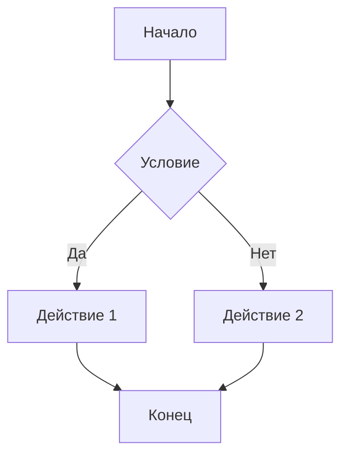
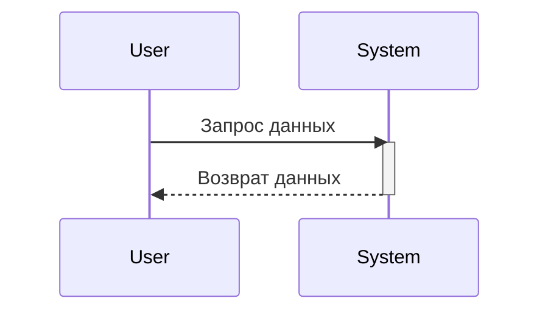
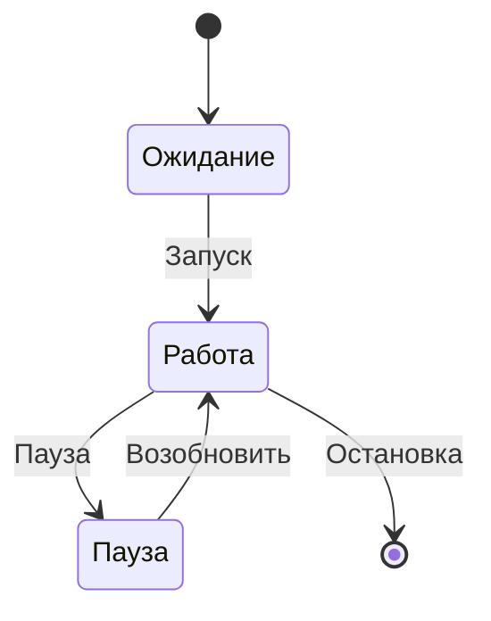
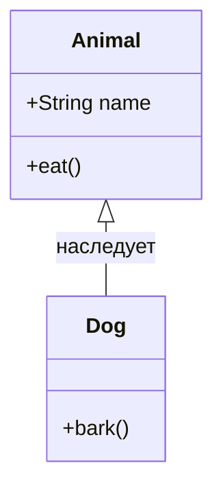
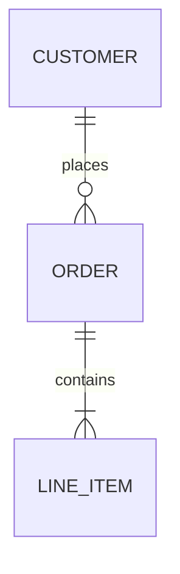
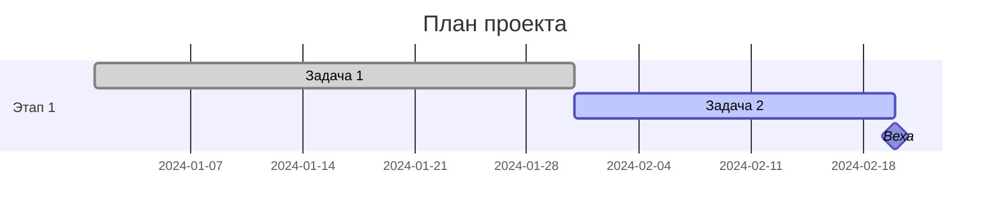
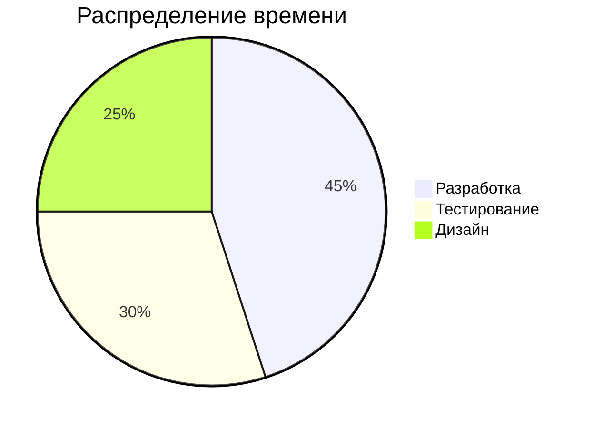
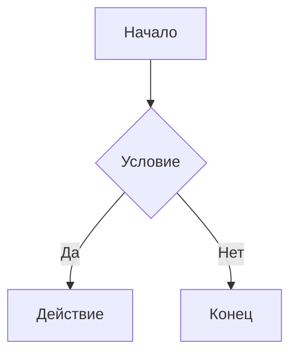
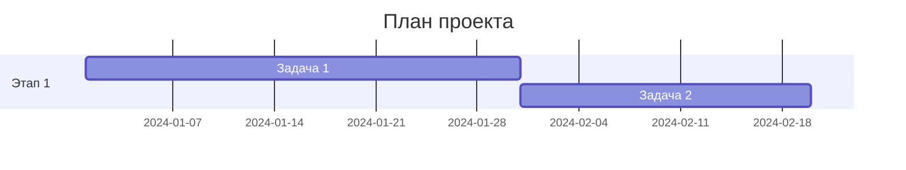
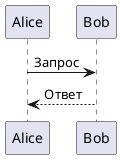

Mermaid — это инструмент для создания диаграмм с помощью текста. Его главное преимущество в том, что схемы описываются кодом, а значит, их можно удобно хранить в системе контроля версий (например, Git), редактировать в любом текстовом редакторе и легко встраивать в документацию, в том числе в файлы `.md`.

В версии Mermaid v11 доступно более 24 типов диаграмм. Вот основные из них, сгруппированные по назначению, с примерами синтаксиса.

### 📊 Основные типы диаграмм

#### Блок-схемы и процессы
**Flowchart** — самый популярный тип для визуализации процессов, алгоритмов и принятия решений.

*   **Синтаксис**: начинается с `flowchart` или `graph`, за которым следует направление (`TD` — сверху вниз, `LR` — слева направо).
*   **Формы узлов**: `[]` — прямоугольник, `()` — скругленный, `{}` — ромб (решение), `(())` — круг, `{{}}` — шестиугольник.
*   **Связи**: `-->` — сплошная стрелка, `-.->` — пунктирная, `==>` — жирная.
*   **Подграфы**: позволяют группировать узлы с помощью `subgraph ... end`.

#### Взаимодействие и поведение
**Sequence Diagram (Диаграмма последовательности)** — показывает обмен сообщениями между участниками во времени.

*   **Синтаксис**: `sequenceDiagram`, участники (`participant`) и сообщения (`->>`, `-->>`). Поддерживает циклы (`loop`), альтернативы (`alt`/`else`) и параллельные действия (`par`).

**State Diagram (Диаграмма состояний)** — моделирует состояния системы и переходы между ними.

*   **Синтаксис**: `stateDiagram-v2` (рекомендуемая версия), начальное (`[*]`) и конечное состояния, переходы с условиями.

**Class Diagram (Диаграмма классов)** — описывает структуру классов, их атрибуты, методы и отношения (наследование, композиция, агрегация).

*   **Синтаксис**: `classDiagram`, модификаторы доступа (`+` public, `-` private, `#` protected), типы связей (`<|--` наследование, `*--` композиция, `o--` агрегация).

**ER Diagram (Диаграмма «сущность-связь»)** — используется для проектирования баз данных.

*   **Синтаксис**: `erDiagram`, сущности и связи с указанием кардинальности (`||--o{` — один-ко-многим).

### 📅 Планирование и данные
**Gantt Chart (Диаграмма Ганта)** — для визуализации графиков проектов, задач и их статусов (выполнено, активно, критический путь).

*   **Синтаксис**: `gantt`, задачи, их статусы и зависимости (`after des1`), вехи (`milestone`).

**Pie Chart (Круговая диаграмма)** — для отображения пропорций и распределений.

*   **Синтаксис**: `pie` с опциональным заголовком `title` и парами «значение: число».

Другие типы для данных и планирования:
- **Mindmap**: для создания интеллект-карт и иерархий.
- **Timeline**: для визуализации хронологии событий.
- **User Journey**: для отображения пути пользователя и его эмоций.
- **Quadrant Chart**: для приоритизации задач по двум осям.
- **XY Chart**: для построения линейных и столбчатых графиков.
- **Sankey Diagram**: для визуализации потоков и распределения ресурсов.

### 🏗️ Архитектура и технические диаграммы
- **Git Graph**: для визуализации стратегий ветвления в Git (коммиты, ветки, слияния).
- **C4 Diagram**: для моделирования архитектуры программного обеспечения на разных уровнях (контекст, контейнеры, компоненты).
- **Architecture Diagram (beta)**: для описания облачной инфраструктуры и сервисов.
- **Requirement Diagram**: для работы с требованиями и их трассировкой (в стиле SysML).
- **Packet Diagram (beta)**: для визуализации структур сетевых пакетов.

### 🎨 Стилизация и настройка
Mermaid позволяет гибко настраивать внешний вид диаграмм.

- **Встроенные темы**: Доступно пять тем: `default`, `dark`, `forest`, `neutral` и `base`.
- **Настройка через Frontmatter**: Внутри блока ````mermaid` можно добавить YAML-конфигурацию для конкретной диаграммы, чтобы изменить тему или заголовок.
    ````markdown
    ```mermaid
    ---
    title: Мой заголовок
    config:
      theme: forest
    ---
    flowchart LR
        A --> B
    ```
    ````
    Этот метод является рекомендуемым для настройки отдельных диаграмм, начиная с версии 10.5.0.
- **CSS-стилизация**: Можно применять собственные CSS-правила для узлов и связей через `classDef` и `class`, а также использовать переменные темы для тонкой настройки цветов (работает только с темой `base`).

### 💡 Интеграция с Markdown
- **Блок кода**: Самый распространенный и универсальный способ — использовать блок кода с указанием языка `mermaid`. Большинство современных редакторов (Obsidian, VS Code, GitHub, GitLab) и статических генераторов сайтов (Hugo, VuePress) поддерживают его рендеринг по умолчанию или с помощью плагина.
- **Директивы (устаревший способ)**: В некоторых средах, например в Azure DevOps, может использоваться синтаксис с `:::mermaid`.

### ⚠️ Важные ограничения
- **Поддержка рендерера**: Возможности Mermaid не являются частью стандарта Markdown. Их поддержка полностью зависит от используемого редактора или платформы. Некоторые типы диаграмм (например, `beta`-версии) могут не отображаться.
- **Темы и кастомизация**: Глубина настройки через CSS или переменные темы также может быть ограничена средой.

Если вы планируете использовать Mermaid в конкретном редакторе и у вас есть вопросы по совместимости, спрашивайте.

![Моя картинка][my-image]

[my-image]: data:image/png;base64,iVBORw0KGgoAAAANSUhEUgAAAAEAAAABCAYAAAAfFcSJAAAADUlEQVR42mNk+M9QDwADhgGAWjR9awAAAABJRU5ErkJggg==


![Синий квадрат][my-blue-img]

[my-blue-img]: data:image/png;base64,iVBORw0KGgoAAAANSUhEUgAAAGQAAABkCAIAAAD/gAIDAAAA6ElEQVR4nO3SsRHAMAwDMcVre/h4BX0P1Kz++M39h52z3CFW41mBWIFYgViBWIFYgViBWIFYgViBWIFYgViBWIFYgViBWIFYgViBWIFYgViBWIFYgViBWIFYgViBWIFYgViBWIFYgViBWIFYgViBWIFYgViBWIFYgViBWIFYgViBWIFYgViBWIFYgViBWIFYgViBWIFYgViBWIFYgViBWIFYgViBWIFYgViBWIFYgViBWIFYgViBWIFYgViBWIFYgViBWIFYgViBWIFYgViBWIFYgViBWIFYgViBWIFYgViBWIFYgViz9wAI3QJCX/skaAAAAABJRU5ErkJggg==


Формула в строке: $a^2 + b^2 = c^2$

$$
\frac{-b \pm \sqrt{b^2 - 4ac}}{2a}
$$

Формула Эйлера: $e^{i\pi} + 1 = 0$
$$
\sum_{n=1}^{10} n^2
$$






```python
print("Hello, World!")
```

- [x] Завершённая задача
- [ ] Невыполненная задача
- [ ] Ещё одна задача

Отличная работа! :tada: :smile:

[[_TOC_]]

# Раздел 1
## Подраздел 1.1
# Раздел 2

<table>
  <tr>
    <th>Заголовок 1</th>
    <th>Заголовок 2</th>
  </tr>
  <tr>
    <td>Ячейка 1</td>
    <td>Ячейка 2</td>
  </tr>
</table>

### Сворачиваемые списки
<details>
<summary>Нажмите, чтобы показать подробности</summary>

Скрытый текст. Внутри можно использовать **Markdown**, списки и код.

- Пункт 1
- Пункт 2

</details>

Это <mark>важное предупреждение</mark> в тексте.

Нажмите <kbd>Ctrl</kbd> + <kbd>C</kbd>, чтобы скопировать.

Формула воды: H<sub>2</sub>O  
Степень: x<sup>2</sup> + y<sup>2</sup>

### Подсказка-расшифровка
<abbr title="Application Programming Interface">API</abbr> — интерфейс программирования.

### Центрирование
<div align="center">

**Центрированный текст**

</div>

<div align="right">
Справа
</div>

### 

<iframe width="560" height="315"
        src="https://www.youtube.com/embed/VIDEO_ID"
        title="YouTube video"
        frameborder="0"
        allowfullscreen>
</iframe>

Прогресс: <progress value="70" max="100">70%</progress>

Нагрузка: <meter value="0.6">60%</meter>

<ruby>漢<rt>kan</rt>字<rt>ji</rt></ruby>

### Якори
<a id="section-1"></a>
**Раздел 1**

[Перейти к разделу 1](#section-1)

<!-- Это служебный комментарий, он не отображается в документе -->

Первая строка<br>
Вторая строка

<hr>

<small>Мелкий текст</small>  
<del>Удалено</del>  
<ins>Добавлено</ins>  
<q>Короткая цитата</q>  
<cite>Название источника</cite>  
<time datetime="2026-10-27">27 октября 2026</time>

<iframe src="https://www.youtube.com/embed/VIDEO_ID"
        title="YouTube video"
        style="width:100%; max-width:640px; aspect-ratio:16/9; border:1px solid #ddd; border-radius:12px; box-shadow:0 8px 24px rgba(0,0,0,.2);"
        allowfullscreen>
</iframe>

<div style="max-width:640px; margin:0 auto; border-radius:12px; overflow:hidden; box-shadow:0 8px 24px rgba(0,0,0,.2);">
  <div style="position:relative; padding-bottom:56.25%; height:0;">
    <iframe src="https://www.youtube.com/embed/VIDEO_ID"
            title="Видео"
            style="position:absolute; top:0; left:0; width:100%; height:100%; border:0;"
            allowfullscreen>
    </iframe>
  </div>
</div>

<iframe src="https://www.google.com/maps/embed?pb=ВАШ_КОД"
        width="600" height="450"
        style="border:0; border-radius:12px; max-width:100%;"
        allowfullscreen=""
        loading="lazy"
        referrerpolicy="no-referrer-when-downgrade">
</iframe>

<iframe height="400"
        style="width:100%; border:1px solid #ddd; border-radius:8px;"
        scrolling="no"
        title="CodePen Embed"
        src="https://codepen.io/USER/embed/PEN_ID?default-tab=html%2Cresult"
        frameborder="no"
        loading="lazy"
        allowtransparency="true"
        allowfullscreen="true">
</iframe>

<div style="background:#fff3cd; border-left:4px solid #ffc107; padding:12px 16px; border-radius:8px;">
  **Внимание:** это важное предупреждение внутри Markdown.
</div>

Это <span style="color:#d73a49; font-weight:700;">красный важный текст</span> в абзаце.

<table style="width:100%; border-collapse:collapse;">
  <tr>
    <th style="border:1px solid #ddd; padding:8px; background:#f6f8fa;">Параметр</th>
    <th style="border:1px solid #ddd; padding:8px; background:#f6f8fa;">Значение</th>
  </tr>
  <tr>
    <td style="border:1px solid #ddd; padding:8px;">Температура</td>
    <td style="border:1px solid #ddd; padding:8px;">+22 °C</td>
  </tr>
</table>

<div style="display:flex; gap:12px; flex-wrap:wrap;">
  <div style="flex:1; min-width:200px; padding:12px; border:1px solid #ddd; border-radius:8px;">
    **Карточка 1**  
    Текст первой карточки.
  </div>
  <div style="flex:1; min-width:200px; padding:12px; border:1px solid #ddd; border-radius:8px;">
    **Карточка 2**  
    Текст второй карточки.
  </div>
</div>

<details style="border:1px solid #ddd; border-radius:8px; padding:8px 12px;">
  <summary style="cursor:pointer; font-weight:700;">Показать подробности</summary>

  Скрытый текст. Внутри работает **Markdown**.
</details>

<div style="max-width:640px; margin:0 auto;">
  <div style="border-radius:12px; overflow:hidden; box-shadow:0 8px 24px rgba(0,0,0,.2);">
    <iframe src="https://www.youtube.com/embed/VIDEO_ID"
            title="Видео"
            style="display:block; width:100%; aspect-ratio:16/9; border:0;"
            allowfullscreen>
    </iframe>
  </div>
  <p style="text-align:center; color:#666; font-size:0.9em; margin-top:8px;">
    Рис. 1. Пример встроенного видео
  </p>
</div>

<style>
.md-hover-card {
  display: inline-block;
  padding: 16px 24px;
  background: #f6f8fa;
  border: 1px solid #d0d7de;
  border-radius: 12px;
  cursor: pointer;
  transition: transform .3s ease, box-shadow .3s ease, background .3s ease, border-color .3s ease;
}
.md-hover-card:hover {
  transform: translateY(-4px) scale(1.03);
  box-shadow: 0 12px 24px rgba(0,0,0,.15);
  background: #eaf5ff;
  border-color: #0969da;
}
</style>

<div class="md-hover-card">
  Наведи на меня — карточка подпрыгнет и подсветится
</div>

<style>
.proj42-card {
  display: inline-block;
  padding: 14px 20px;
  border-radius: 10px;
  background: linear-gradient(135deg, #ffffff, #f0f4ff);
  border: 1px solid #c7d2fe;
  transition: transform .25s ease, box-shadow .25s ease;
}
.proj42-card:hover {
  transform: rotate(-1deg) translateY(-3px);
  box-shadow: 0 10px 20px rgba(79,70,229,.25);
}
</style>

<div class="proj42-card">Уникальный класс proj42-card</div>

<style>
@keyframes md-pulse {
  0%, 100% { box-shadow: 0 0 0 0 rgba(9,105,218,.45); }
  50%      { box-shadow: 0 0 0 14px rgba(9,105,218,0); }
}
.md-live-badge {
  display: inline-block;
  padding: 6px 14px;
  border-radius: 999px;
  background: #0969da;
  color: #fff;
  font-weight: 600;
  animation: md-pulse 2s infinite;
}
</style>

<span class="md-live-badge">● LIVE</span>

<svg width="260" height="90" xmlns="http://www.w3.org/2000/svg" role="img">
  <style>
    .hov g { transition: transform .3s ease, filter .3s ease; transform-origin: 130px 45px; }
    .hov:hover g { transform: scale(1.06); filter: drop-shadow(0 8px 16px rgba(0,0,0,.25)); }
    .hov rect { transition: fill .3s ease, stroke .3s ease; }
    .hov:hover rect { fill: #0969da; stroke: #074fa6; }
    .hov text { transition: fill .3s ease; pointer-events: none; }
    .hov:hover text { fill: #ffffff; }
  </style>

  <g class="hov">
    <rect x="10" y="15" width="240" height="60" rx="12"
          fill="#f6f8fa" stroke="#d0d7de" stroke-width="1"/>
    <text x="130" y="52" text-anchor="middle"
          font-family="sans-serif" font-size="16" fill="#1f2328">
      Наведи на SVG-карточку
    </text>
  </g>
</svg>

<svg width="240" height="60" xmlns="http://www.w3.org/2000/svg" role="img">
  <rect x="0" y="0" width="240" height="60" rx="12" fill="#0969da">
    <animate attributeName="opacity" values="1;0.4;1" dur="2s" repeatCount="indefinite"/>
  </rect>
  <text x="120" y="38" text-anchor="middle"
        font-family="sans-serif" font-size="16" fill="#ffffff">
    Пульсирующий блок
  </text>
</svg>

<style>
.md-tilt {
  max-width: 420px;
  margin: 8px 0;
  padding: 16px 20px;
  border-radius: 14px;
  background: #ffffff;
  border: 1px solid #e5e7eb;
  transition: transform .35s cubic-bezier(.2,.7,.3,1), box-shadow .35s ease;
}
.md-tilt:hover {
  transform: perspective(600px) rotateX(4deg) rotateY(-4deg) translateY(-4px);
  box-shadow: 0 16px 32px rgba(0,0,0,.18);
}
</style>

<div class="md-tilt">

**Карточка с 3D-наклоном**

Внутри работают списки, формулы $E=mc^2$, ссылки и код.

- Пункт A
- Пункт B

</div>


Это утверждение требует пояснения. 

![ывапаот][my-blue-img]

[my-blue-img]: Текст сноски с дополнительными деталями.


